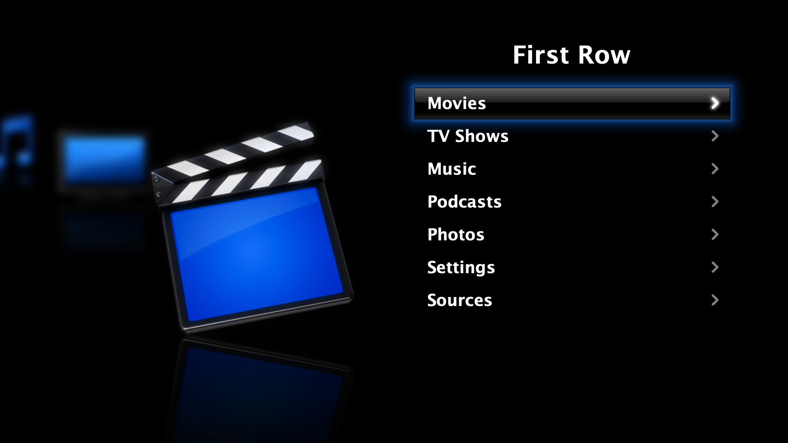
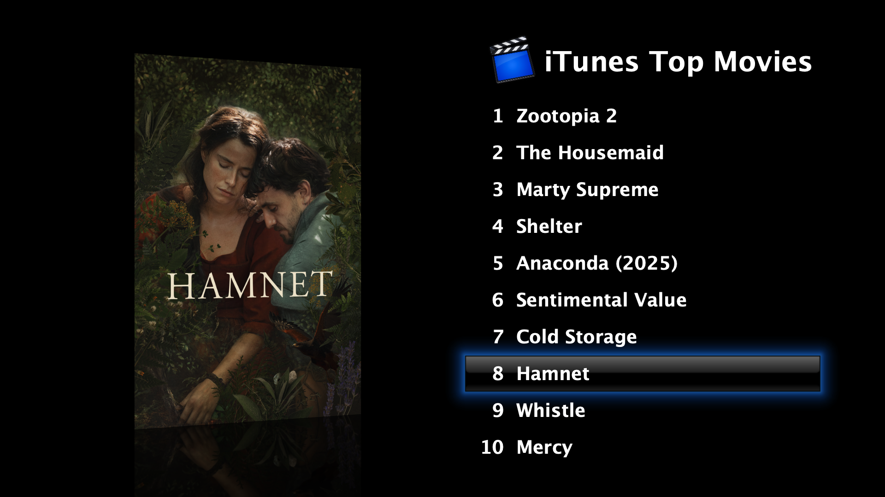
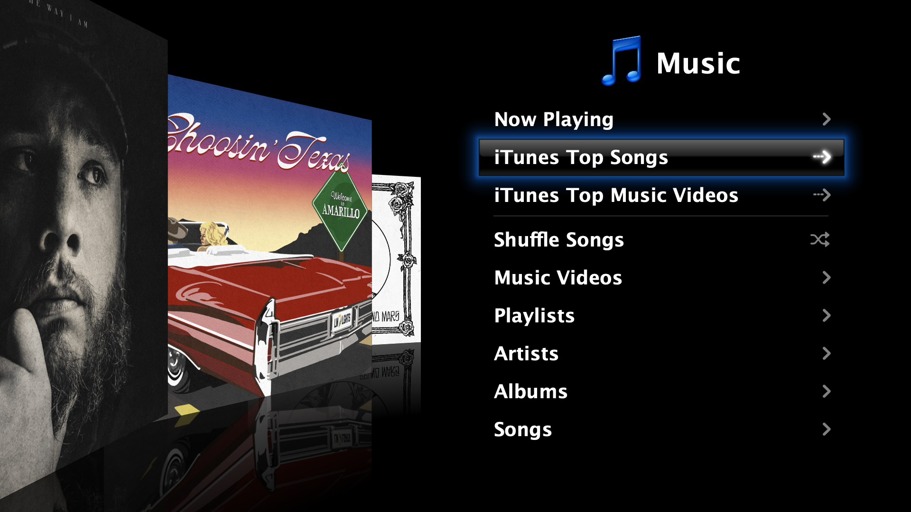
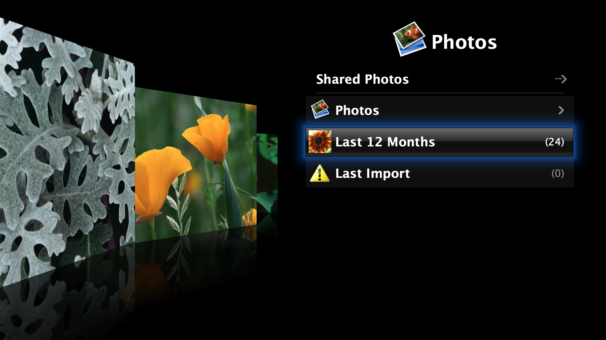
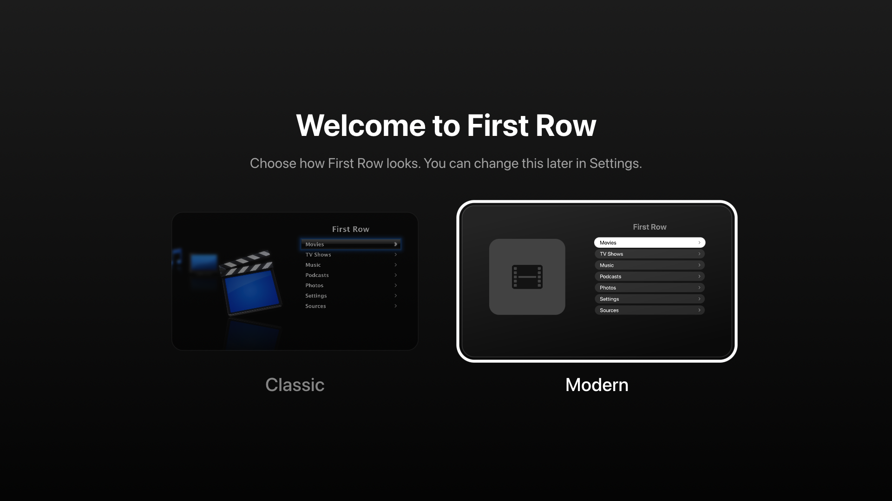
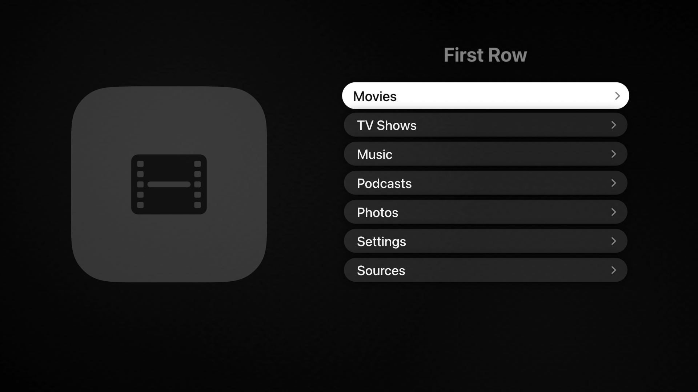
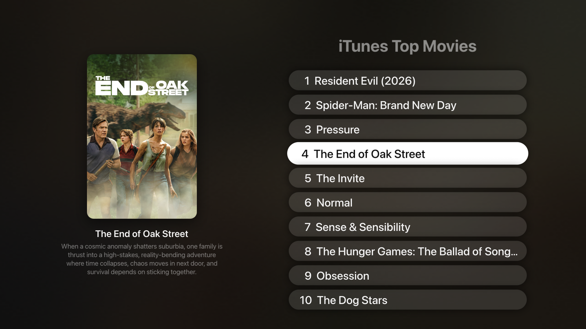
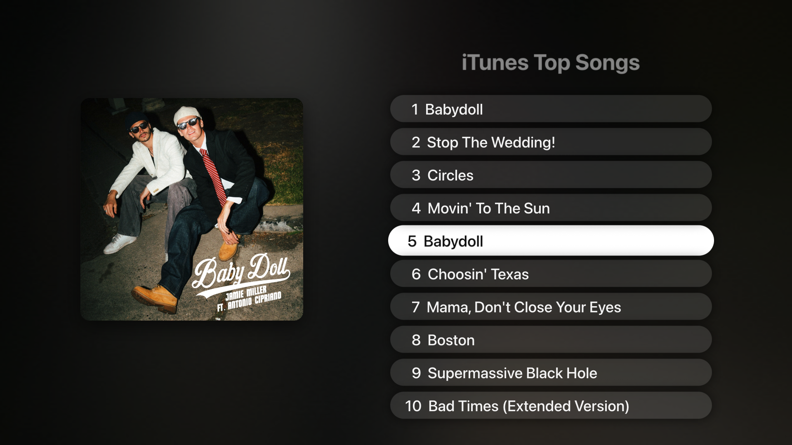
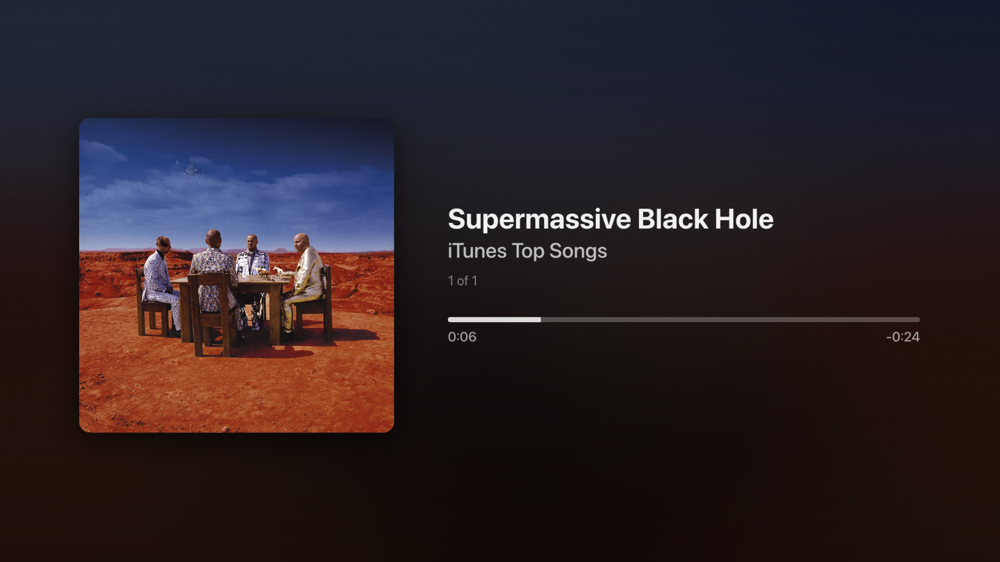
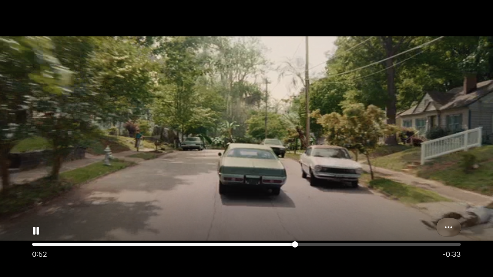

# First Row


https://github.com/user-attachments/assets/b3da5b1c-5bcb-4631-8510-65d43df6738f


First Row brings back **Front Row**, the media centre that came with Mac OS X Tiger through Snow Leopard and ran the first Apple TV. It's rebuilt from scratch in Swift on Core Animation, with the menus, carousels, sounds and transitions matched to the Leopard and Snow Leopard version.

It runs on macOS 10.15 Catalina and later, on iPhone, iPad and Apple TV (iOS and tvOS 15.6 and later), and there are builds for Linux and Windows on the [Releases](https://github.com/JacksonDam/FirstRow/releases) page.

There are two looks. **Classic** is the original, down to the pixel. **Modern** is a flatter take in the style of today's Apple TV, with capsule rows, a large preview card, artwork-tinted backgrounds, Liquid Glass controls on macOS 26 and iOS 26+, and its own softer sounds. You pick one the first time you open First Row and can switch any time in Settings.

## Classic

<p align="center">
  
  
  
</p>
<p align="center">
  
  
  
</p>

## Modern

<p align="center">
  
  
  
</p>
<p align="center">
  
  
  
</p>

## What's in it

- **Movies** from your Movies folder, external drives and network shares (anything in a `Movies` folder at the top of a volume), plus any folders you add in Settings. Besides MP4, MOV and M4V it plays MKV, AVI, WMV, FLV, WebM, MPEG, transport streams and most other kinds of movie file, DVDs and Blu-rays kept as a folder or a disc image among them, with the subtitles and audio tracks inside them, subtitle files kept beside them, and their chapters. Movies remember where you stopped, even after quitting, and show up in Continue Watching. Press `Down` while one plays for subtitles, audio track, chapter and speed.
- **DVD** at the top of the main menu while there's a DVD to play: a disc in a drive (a built-in one, a USB SuperDrive or any other), or a disc image that's open. A DVD that isn't protected against copying plays in First Row. One that is protected opens in the DVD player that comes with the Mac, or in a Windows PC's own DVD player app if it has one; on Linux it plays where the system is set up for such discs.
- **Music** from your library and Apple Music, or folders and an iTunes library file you add in Settings (macOS), with a Now Playing screen that shows lyrics, lists the songs around the one playing and slowly flips the player round to protect the screen from burn-in.
- **Spotify** under Music: your Liked Songs, playlists, albums and artists, playing in the same Now Playing screen. You sign in once on Spotify's own page.
- **Media servers** under Sources: Jellyfin, Emby, Plex, Kodi, and anything that speaks UPnP, such as Windows Media Center, Windows Media Player, most network drives and many TV recorders. First Row finds the ones on your network, or you add one by its address. You sign in to Jellyfin with Quick Connect or a password, to Emby with a password, and to Plex with a code. Videos and songs play in First Row's own players, and Jellyfin, Emby, Plex and Kodi are told where you stopped.
- **Shared folders** under Sources, on the Mac, iPhone, iPad and Apple TV: the folders another computer or a network drive shares, browsed and played from where they are, with a name and password where they want one.
- **Dropbox, Google Drive, OneDrive and iCloud Drive**: where their apps keep a folder on the computer, Settings > Media Folders offers it by name (macOS, Windows, Linux), and a movie or song that is still with its service is fetched when you play it. On iPhone and iPad, Settings > Add Movies from Files brings movies in from anywhere the Files app reaches.
- **Photos** from Apple Photos, an iPhoto library or folders you add in Settings, as slideshows with music and a Ken Burns effect.
- **Podcasts** you've downloaded in Apple Podcasts (macOS).
- **iTunes Top Charts** for movies, TV episodes, songs and music videos, with playable previews.
- **A screen saver** of floating photos, after anything from a minute to an hour of inactivity.
- **A short intro movie** in each look's style, with its own score. It plays every time First Row opens, unless you turn off Settings > Intro Movie. Any key, click or tap skips it. It plays in 4K on a Mac with Apple silicon, and in 1080p everywhere else.
- **An upright layout on iPhone Duo.** Opened out and held upright, First Row arranges itself around the fold: the carousel or preview card, the movie or the album cover sits above it, and the menu or the playback controls below. Turn it sideways and it glides back to the usual layout.
- **Media keys, Control Center and headphone buttons** on macOS, iOS and tvOS, with whatever's playing shown in the system's Now Playing.

Movies and shows bought from the Apple TV app won't play because of their DRM.

On the Mac, iPhone, iPad and Apple TV, the kinds of movie file beyond MP4, MOV and M4V, and shared folders, need macOS 15, iOS 18 or tvOS 18. On older systems First Row plays what the system's own player can, as before.

## Controls

| | |
|---|---|
| **Keyboard** | Arrow keys move, `Return` chooses, `Esc` or `Delete` goes back, `Space` plays and pauses. `Cmd+Esc` quits on a Mac, `Ctrl+Esc` or `Ctrl+Q` elsewhere. |
| **Mouse or trackpad** (macOS, Linux, Windows) | Point at a row and click it. Scroll long lists, use the on-screen Back button, and click or drag the progress bar to seek. In Now Playing, move to the right edge for the song list. |
| **Touch** (iPhone, iPad) | Tap a row to open it. Drag a list to scroll it, or hold and slide to move through it. Swipe in from the left or tap Back to go back. In Now Playing, swipe in from the right for the song list. |
| **Siri Remote** (Apple TV, or paired with a Mac) | Swipe or click the clickpad to move, click the centre to choose, Back goes back, Play/Pause plays and pauses. On a Mac, the TV button opens Now Playing's song list and the volume buttons set the Mac's volume. On Apple TV, where that button belongs to the system, hold the clickpad's centre in Now Playing for the song list. |
| **Apple Remote** (Macs with an infrared receiver) | `+` and `-` move in menus and set the volume during playback. `⏮` and `⏭` move left and right, or change song in Now Playing (hold them to scrub). The centre button chooses and plays, `Menu` goes back. |
| **Game controller** | D-pad or left stick moves, `A` chooses, `B` or `Menu` goes back, `X` plays and pauses. |

All of them work at once, with nothing to turn on. First Row follows whatever you used last: touch or the mouse brings up on-screen buttons like Back and the playback controls, and a key, a remote or a game controller puts them away again.

In Now Playing, `Up` and `Down` change song, `Left` and `Right` scrub, and `Return` shows the lyrics. In a movie, tap `Left` or `Right` to skip 10 seconds or hold them to scrub, and press `Down` for subtitles, audio and speed.

## Building

Open `First Row.xcodeproj` in Xcode and run the **First Row** scheme for macOS, iOS or tvOS. To have it play the further kinds of movie file, build the media engine first with `MediaEngine/build.sh` (see [`MediaEngine/README.md`](MediaEngine/README.md)): the app's build picks it up from there. The Linux and Windows builds use the Swift package in `Package.swift` and need SDL 3 and mpv (see [`Portable/README.md`](Portable/README.md)).

## How it's put together

```
firstrow/
├── AppShell.swift, AppDelegate.swift   Launch, windows, input routing
├── MenuView.swift, MenuView+*.swift    The app's state and behaviour, split by area
├── Engine/                             The Core Animation renderer: menus, carousels, previews, players
├── MenuConfiguration.swift             The list of top-level menus
├── Movies.frappliance/                 Movies, Continue Watching and iTunes Top Movies
├── TV.frappliance/                     iTunes Top TV Episodes
├── Music.frappliance/                  Music library, Spotify, Now Playing
├── Podcasts.frappliance/               Podcasts
├── Photos.frappliance/                 Photos and slideshows
├── FRSettings.frappliance/             Settings, media folders and the screen saver
├── FRSources.frappliance/              Sources and Jellyfin support
├── Assets.xcassets, Sounds/, Videos/   Images, interface sounds and the two intro movies
├── Videos4K/                           The intro movies in 4K, which only the Mac app carries
└── ScreenSaverDefaultPhotos/           Photos for the screen saver
Portable/                               Stand-ins for Apple's frameworks on Linux and Windows
```

Each `.frappliance` folder holds one top-level menu, and the idea is for each to become a separately loadable plugin.

### Adding a menu

Say you want a **NewTube** item on the main menu.

1. Make a `NewTube.frappliance` folder with a feature that describes the item and its submenu:

   ```swift
   struct NewTubeMenuFeature: MenuFeatureConfiguration {
       let rootItem = RootMenuItemConfig(id: "newtube", title: "NewTube", iconAssetName: "newtube")
       let submenuItems: [SubmenuItemConfig] = [
           .init(id: "newtube_playlists", title: "Playlists", leadsToMenu: true),
           .init(id: "newtube_videos", title: "Videos", leadsToMenu: true),
       ]
   }
   ```

   Set `leadsToMenu` for rows that open another list, and override `defaultSubmenuSelectedIndex` if the submenu shouldn't start on its first row.

2. Add a `newtube` image set to `Assets.xcassets` for the main menu's carousel.

3. Add `NewTubeMenuFeature()` to the catalog in `MenuConfiguration.swift`. Its place in that list is its place on the main menu.

   The item now shows up, opens and closes with the right sounds, and lists its rows.

4. Make the rows do something in `triggerSubmenuAction()` in `MenuView+InputHandling.swift`:

   ```swift
   if activeRootItemID == "newtube", item.id == "newtube_playlists" {
       playSound(named: "Selection")
       enterNewTubePlaylistsMenu()
       return
   }
   ```

For a third level of lists, add a case to `ThirdMenuMode` in `MenuView+MenuNavigation.swift`, fill in `thirdMenuItems` and set `thirdMenuMode` when the row is chosen; `enterMoviesFolderMenu()` is a good example. The picture beside the list comes from `gapContentItems(sceneSize:pass:memo:)` in `MenuView+GapContent.swift`, which can show the item's icon (the default), a preview, details or a carousel of covers.

## Thanks

If you'd like to support the project, you can [buy me a coffee](https://buymeacoffee.com/gameroof1w).

## Credits

> <sub>"macbook pro M3 16 inch 2024" by jackbaeten, "iPhone 17 Pro" by Ranguel, "Apple Tv 4k 3rdgen Wifi Siri Remote 3rdgen" by polyman and "LG OLED55G56LS OLED Evo TV" by Ram-je (Sketchfab, CC BY 4.0). "Apple iPhone Duo Fold Star White 2026" by extraakash (Sketchfab). Wurlitzer EP200 samples by Greg Sullivan (CC BY 3.0).</sub>

## What it's made with

The other people's work that goes out with First Row, and the terms each part comes under, are listed in [`MediaEngine/README.md`](MediaEngine/README.md) for the Mac, iPhone, iPad and Apple TV apps and in [`Portable/Licenses/README.md`](Portable/Licenses/README.md) for Linux and Windows. The licences' own texts are inside each download.

## License

[Creative Commons Attribution 4.0](https://creativecommons.org/licenses/by/4.0/)
