# First Row


https://github.com/user-attachments/assets/b3da5b1c-5bcb-4631-8510-65d43df6738f


First Row brings back **Front Row**, the media centre that came with Mac OS X Tiger through Snow Leopard and ran the first Apple TV. It's rebuilt from scratch in Swift on Core Animation, with the menus, carousels, sounds and transitions matched to the Leopard and Snow Leopard version.

It runs on macOS 10.15 Catalina and later, on iPhone, iPad and Apple TV (iOS and tvOS 15.6 and later), and there are builds for Linux and Windows on the [Releases](https://github.com/JacksonDam/FirstRow/releases) page.

There are two looks. **Classic** is the original, down to the pixel. **Modern** is a flatter take in the style of today's Apple TV, with capsule rows, a large preview card, artwork-tinted backgrounds, Liquid Glass controls on macOS 26 and iOS 26+, and its own softer sounds. You pick one the first time you open First Row and can switch any time in Settings.

## Classic

<p align="center">
  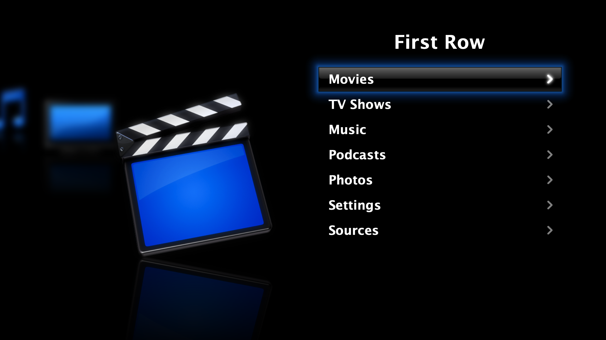
  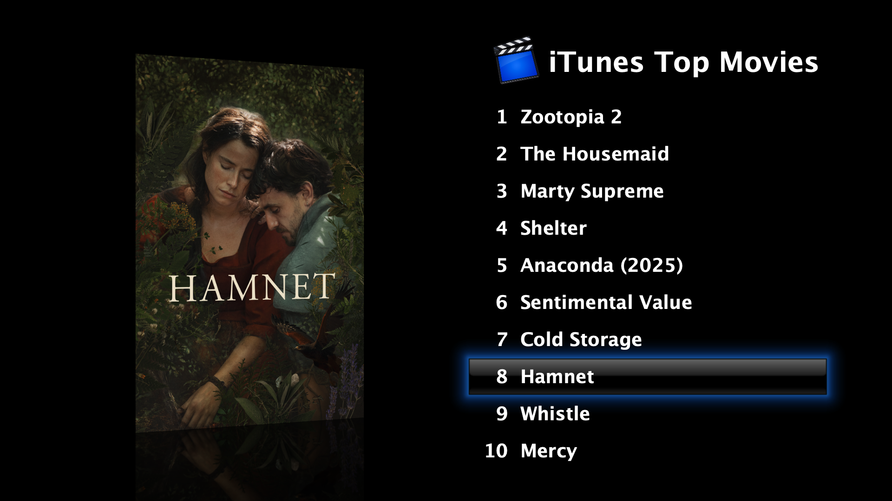
  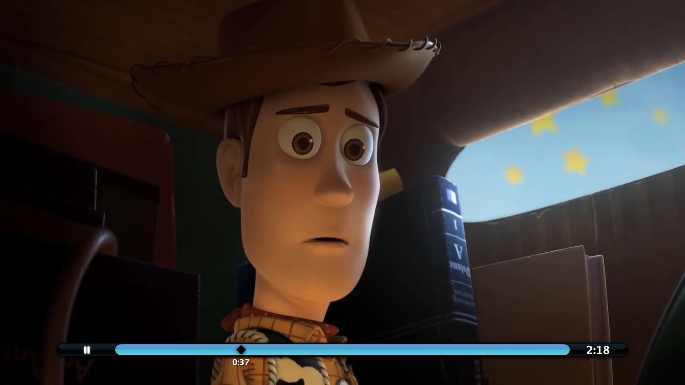
</p>
<p align="center">
  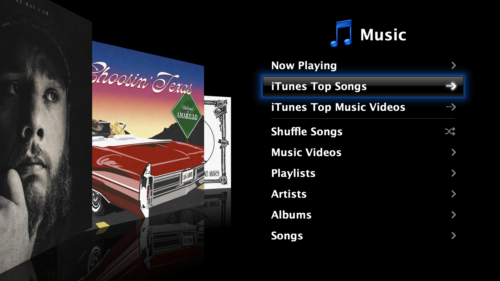
  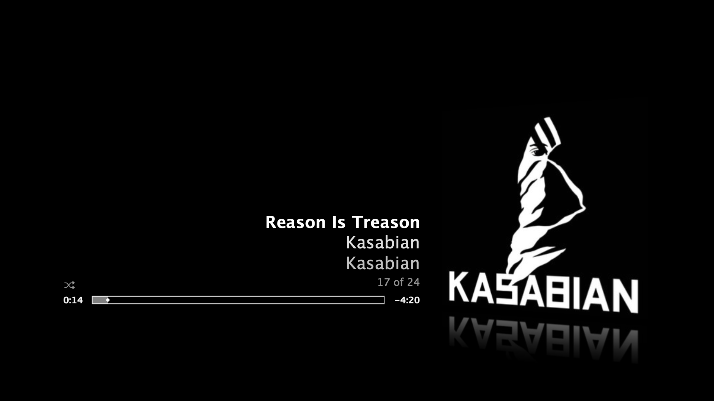
  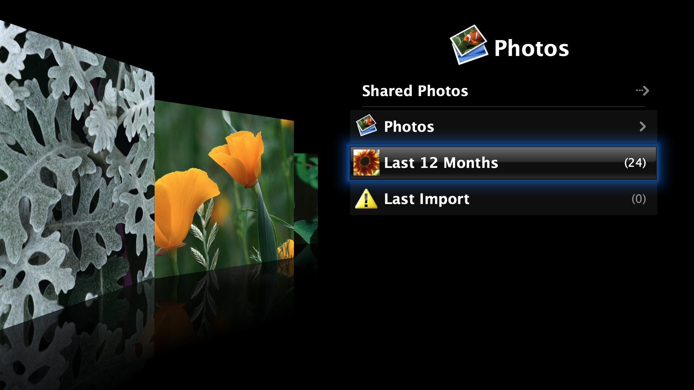
</p>

## Modern

<p align="center">
  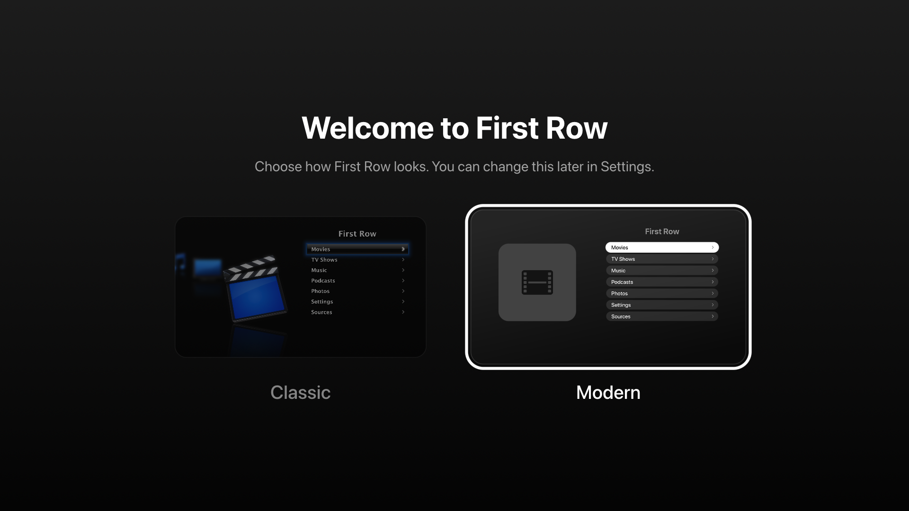
  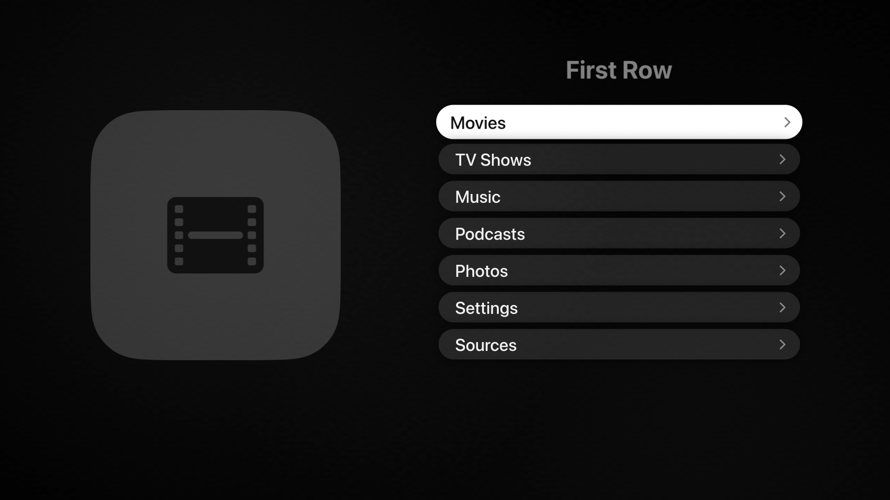
  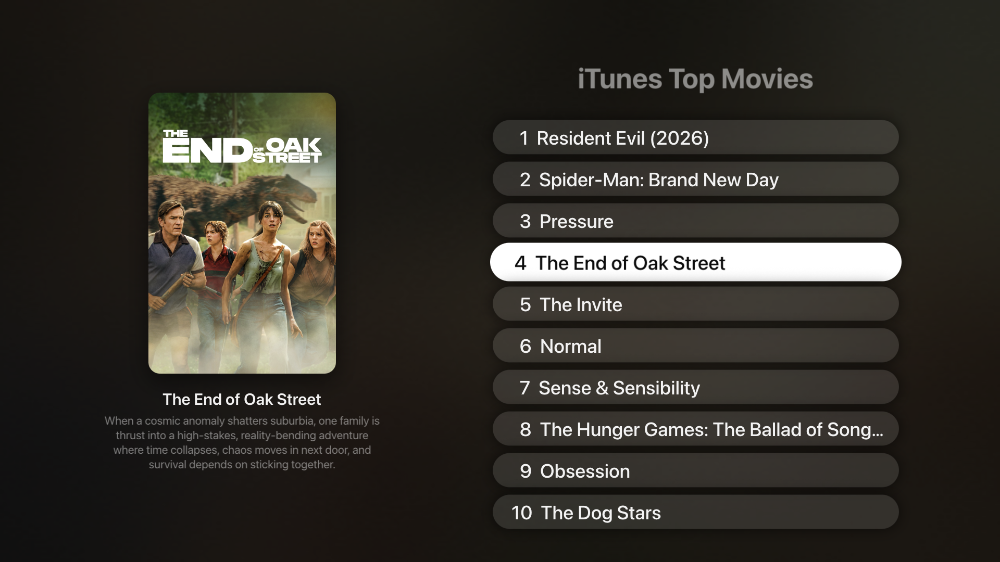
</p>
<p align="center">
  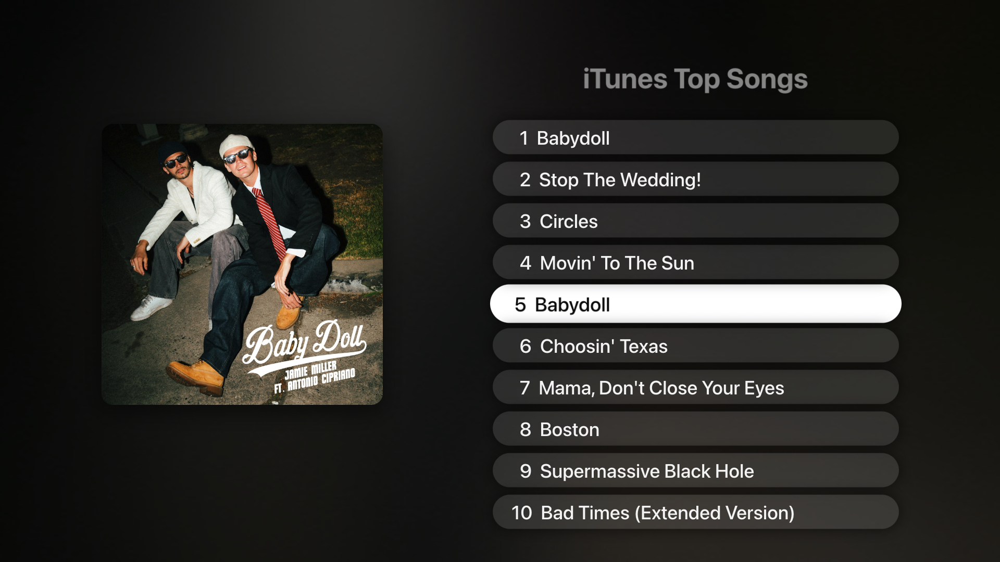
  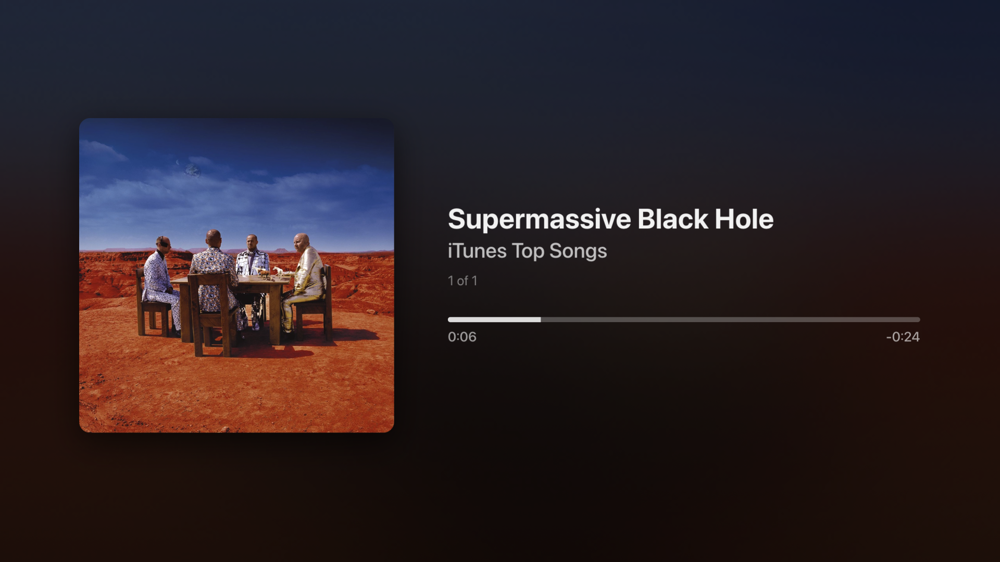
  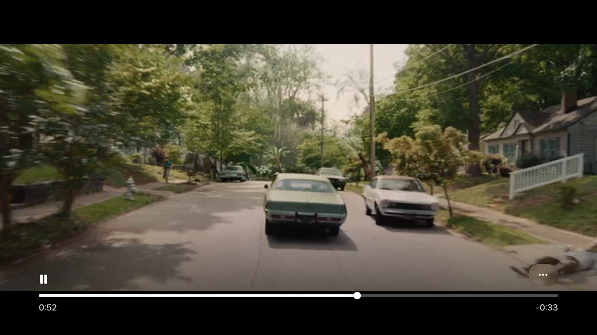
</p>

## What's in it

- **Movies** from your Movies folder, external drives, network shares and folders you add with Movies > Import or Settings > Media Folders. Plays MP4, MOV, M4V, MKV, AVI, WMV, WebM, MPEG, transport streams and more, including DVD and Blu-ray folders and disc images, with their subtitles, audio tracks and chapters. Picks up where you left off, with a Continue Watching list. Hold select on an item to delete or remove it.
- **TV Shows** sorted from episode file names (`Show Name S01E02`, `Show Name/Season 1/02 Title`), by show or by date.
- **DVD** playback from a drive or a mounted disc image. Copy-protected discs open in the system's DVD player app (on Linux, they play if the system is set up for them).
- **Music** from your library, Apple Music, and folders or an iTunes library file you add (macOS). Gapless playback for local files, and a Now Playing screen with the song list, lyrics and burn-in protection. Lyrics come from `.lrc` files, tags, your library or your media server, or from [LRCLIB](https://lrclib.net) when a song has none.
- **Spotify**: your Liked Songs, playlists, albums and artists, after signing in on Spotify's page.
- **Media servers** under Sources: Jellyfin, Emby, Plex, Kodi and UPnP servers such as Windows Media Player and most network drives, found automatically or added by address. Playback position is synced back to Jellyfin, Emby, Plex and Kodi.
- **Shared folders** (SMB) under Sources, with an optional name and password. To reach a Mac from an Apple TV or a PC, turn on Windows File Sharing in the Mac's File Sharing options. Linux needs libsmbclient.
- **Cloud folders** from Dropbox, Google Drive, OneDrive and iCloud Drive, added with Movies > Import (the Files picker on iPhone and iPad) or Settings > Media Folders. Files that aren't downloaded yet are fetched when played.
- **Photos** from Apple Photos, iPhoto libraries or folders, as slideshows with music and a Ken Burns effect.
- **Podcasts** downloaded in Apple Podcasts (macOS).
- **iTunes Top Charts** for movies, TV episodes, songs and music videos, with previews.
- **A screen saver** of floating photos.
- **MetalFX video upscaling** on Apple silicon Macs (macOS 13 and later, off by default): sharper scaling for video smaller than the screen. It isn't used for HDR or for formats First Row decodes itself, such as DVDs.
- **An intro movie** for each look, which you can skip or turn off in Settings.
- **An upright layout on iPhone Duo**, with the picture above the fold and the menu or controls below.
- **Media keys, Control Center and headphone controls** on macOS, iOS and tvOS.

Movies and shows bought from the Apple TV app won't play because of their DRM.

Supported system languages: English, German, French, Spanish, Japanese, Korean, Chinese (Simplified) and Chinese (Traditional). On Linux, Chinese, Japanese and Korean need a font such as Noto Sans CJK.

On Apple platforms, shared folders, and HDR, Dolby Vision, Dolby Atmos and picture in picture for formats other than MP4, MOV and M4V, need macOS 15, iOS 18 or tvOS 18.

## Controls

| | |
|---|---|
| **Keyboard** | Arrow keys move, `Return` selects, `Esc` or `Delete` goes back, `Space` plays and pauses. Quit with `Cmd+Esc` on a Mac, or `Ctrl+Esc` or `Ctrl+Q` elsewhere. |
| **Mouse or trackpad** (macOS, Linux, Windows) | Click a row, scroll lists, and click or drag the progress bar to seek. |
| **Touch** (iPhone, iPad) | Tap a row, drag to scroll, and swipe in from the left to go back. |
| **Siri Remote** | The clickpad moves and selects, Back goes back, Play/Pause plays and pauses. |
| **Apple Remote** | `+` and `-` move and set the volume, `⏮` and `⏭` move or change song, the centre button selects, `Menu` goes back. |
| **Game controller** | D-pad or left stick moves, `A` selects, `B` goes back, `X` plays and pauses. |

All of them work at the same time. On-screen buttons appear when you use touch or a mouse.

In Now Playing, `Up` and `Down` change song, `Left` and `Right` scrub, `L` or `Return` shows the lyrics and `Tab` shows the song list. The lyrics also open with the button in the bottom right corner, `Y` on a game controller, or the centre button on a Siri Remote (hold it on an Apple Remote). In a movie, `Left` and `Right` skip 10 seconds (hold to scrub), and `Down` opens subtitles, audio and speed.

## Building

Open `First Row.xcodeproj` in Xcode and run the **First Row** scheme for macOS, iOS or tvOS. To play MKV, AVI and the other formats, first build the media engines with `MediaEngine/build.sh` and `MediaEngine/Older/build.sh` (see [`MediaEngine/README.md`](MediaEngine/README.md)). The Linux and Windows builds use the Swift package in `Package.swift` and need SDL 3 and mpv (see [`Portable/README.md`](Portable/README.md)).

## How it's put together

```
firstrow/
├── AppShell.swift, AppDelegate.swift   Launch, windows, input routing
├── MenuView.swift, MenuView+*.swift    The app's state and behaviour, split by area
├── Engine/                             The Core Animation renderer: menus, carousels, previews, players
├── MenuConfiguration.swift             The list of top-level menus
├── Movies.frappliance/                 Movies, Continue Watching and iTunes Top Movies
├── TV.frappliance/                     TV Shows and iTunes Top TV Episodes
├── Music.frappliance/                  Music library, Spotify, Now Playing
├── Podcasts.frappliance/               Podcasts
├── Photos.frappliance/                 Photos and slideshows
├── FRSettings.frappliance/             Settings, media folders and the screen saver
├── FRSources.frappliance/              Sources and Jellyfin support
├── Assets.xcassets, Sounds/, Videos/   Images, interface sounds and the two intro movies
├── Videos4K/                           The Mac app's intro movies
└── ScreenSaverDefaultPhotos/           Photos for the screen saver
Portable/                               Stand-ins for Apple's frameworks on Linux and Windows
```

Each `.frappliance` folder is one top-level menu, and is meant to become a separately loadable plugin.

### Adding a language

Interface text is written in English inside `L("...")`, and each other language is a table from English to that language (`firstrow/German.swift`, `French.swift` and so on). To add one, add a case to `AppLanguage` in `firstrow/Localization.swift`, a table like `German.swift`, and an `InfoPlist.strings` in a new `.lproj` folder for the system's permission prompts.

### Adding a menu

To add a **NewTube** item to the main menu:

1. Make a `NewTube.frappliance` folder with a feature that describes the item and its submenu:

   ```swift
   struct NewTubeMenuFeature: MenuFeatureConfiguration {
       let rootItem = RootMenuItemConfig(id: "newtube", title: "NewTube", iconAssetName: "newtube")
       let submenuItems: [SubmenuItemConfig] = [
           .init(id: "newtube_playlists", title: "Playlists", leadsToMenu: true),
           .init(id: "newtube_videos", title: "Videos", leadsToMenu: true),
       ]
   }
   ```

   Set `leadsToMenu` for rows that open another list, and override `defaultSubmenuSelectedIndex` if the submenu shouldn't start on its first row.

2. Add a `newtube` image set to `Assets.xcassets` for the main menu's carousel.

3. Add `NewTubeMenuFeature()` to the catalog in `MenuConfiguration.swift`. Its position in that list is its position on the main menu. The item now shows up, opens and closes with the right sounds, and lists its rows.

4. Handle the rows in `triggerSubmenuAction()` in `MenuView+InputHandling.swift`:

   ```swift
   if activeRootItemID == "newtube", item.id == "newtube_playlists" {
       playSound(named: "Selection")
       enterNewTubePlaylistsMenu()
       return
   }
   ```

For a third level of lists, add a case to `ThirdMenuMode` in `MenuView+MenuNavigation.swift`, fill in `thirdMenuItems` and set `thirdMenuMode` when the row is chosen (see `enterMoviesFolderMenu()`). The picture beside the list comes from `gapContentItems(sceneSize:pass:memo:)` in `MenuView+GapContent.swift`, which can show the item's icon (the default), a preview, details or a carousel of covers.

## Thanks

If you'd like to support the project, you can [buy me a coffee](https://buymeacoffee.com/gameroof1w).

## Credits

> <sub>"macbook pro M3 16 inch 2024" by jackbaeten, "iPhone 17 Pro" by Ranguel, "Apple Tv 4k 3rdgen Wifi Siri Remote 3rdgen" by polyman and "LG OLED55G56LS OLED Evo TV" by Ram-je (Sketchfab, CC BY 4.0). "Apple iPhone Duo Fold Star White 2026" by extraakash (Sketchfab). Wurlitzer EP200 samples by Greg Sullivan (CC BY 3.0).</sub>

## What it's made with

The open source work that ships with First Row, and its licences, are listed in [`MediaEngine/README.md`](MediaEngine/README.md) for the Mac, iPhone, iPad and Apple TV apps and in [`Portable/Licenses/README.md`](Portable/Licenses/README.md) for Linux and Windows. The full licence texts are included in each download.

## License

First Row is licensed under [Creative Commons Attribution 4.0](LICENSE.md). The open source components above keep their own licences.

## Security

To report a vulnerability, see [`SECURITY.md`](SECURITY.md).
